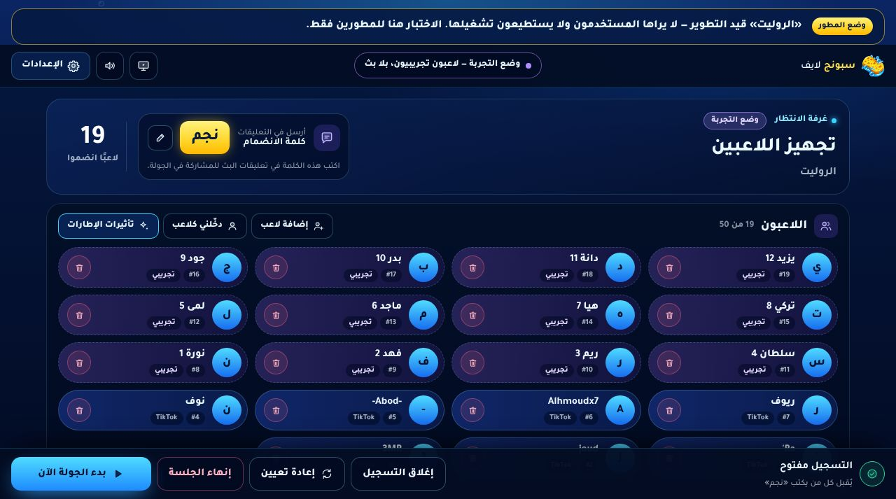
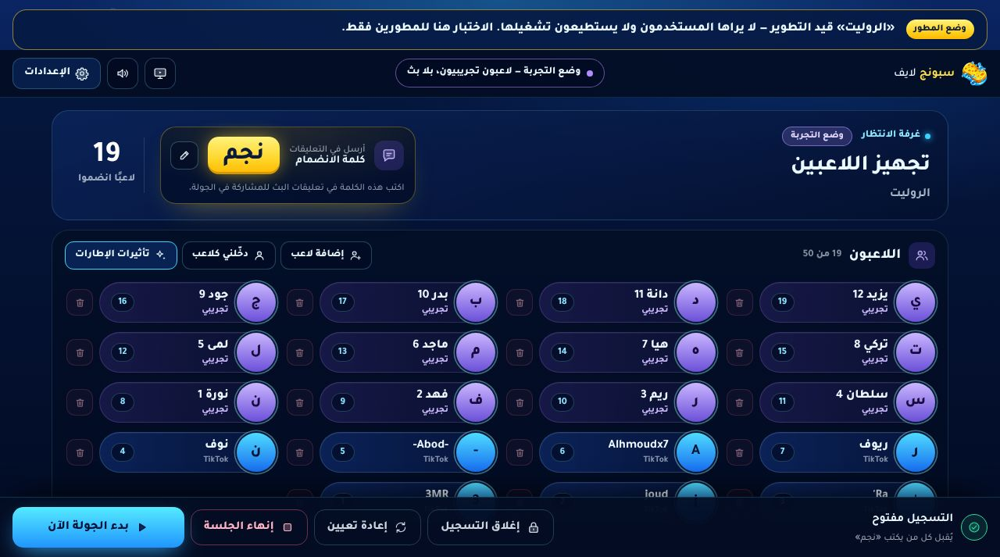
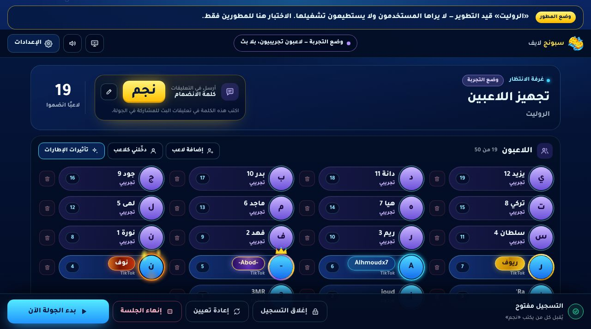
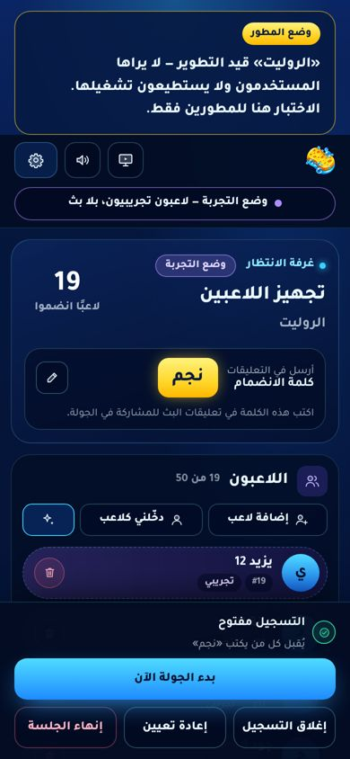
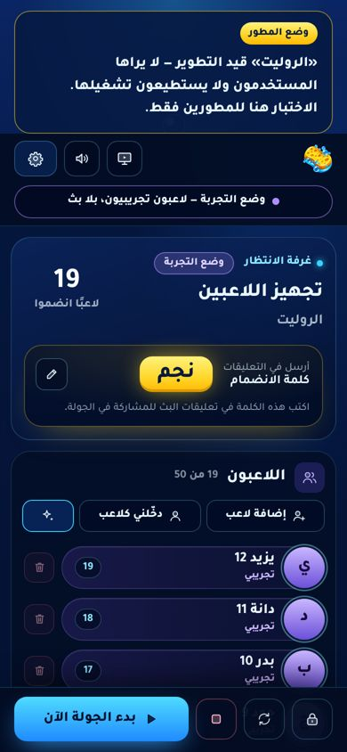

# «غرفة الانتظار» — the lobby redesign

The owner asked for a lobby as professional as a reference screenshot from another streaming-games product. Its
layout ideas were used (a header with the join word, slim framed nameplates, one main action), not its look: the
lobby keeps Sponge Live's own identity (navy, cyan, the sponge yellow, Tajawal) and its own frames.

## What changed (`public/lobby.css`, `public/studio.js`, `public/studio.html`)

| | Before | After |
|---|---|---|
| Players | big cards: large letter, a number pill, a source pill, dashed borders for trial players | slim nameplates (52 px): the avatar overlaps the plate's edge (a frame ring can reach beyond it), the name, one quiet line saying where the player comes from (TikTok, Kick, تجريبي, يدوي, المضيف, the frame's name), the number at the end |
| Remove | a red circle inside every card | a quiet button beside the plate, full strength on hover/focus (always on touch screens) |
| Frames | the same card with or without a frame | the frame is the only bright thing on a plate; trial players are violet, the host gold |
| Join word | a small yellow badge | the hero of the header: 30 px, glowing, in a card lit by its own yellow |
| Bar (desktop) | four equal buttons | one main action («بدء الجولة الآن»); registration, reset and end are quiet; each has an icon |
| Bar (phone) | ~170 px: status, a full-width button, three buttons under it, the list visible through it | one 64 px row: three 46 px icon buttons (named for screen readers) and the main action; solid background |

Motion: only when a player joins (the plate arrives with a short cyan glow). Reduced motion turns it off.

## Tests

`tests/lobby-ui.test.mjs` (new, Playwright, needs PostgreSQL like the other studio tests):
- a nameplate per player (name, number, avatar, remove beside it, ≤ 56 px), trial players marked, a viewer removed from the
  list, the registration button names its action and follows the state, one main action;
- phone (360 px): the bar is one row and ≤ 84 px, every visible button ≥ 44 px and named, no sideways scroll.

Both fail on the old lobby and pass on the new one. `tests/perf.test.mjs`, `tests/launch-flow.test.mjs` and
`tests/roulette-ui.test.mjs` pass (one roulette-ui studio test failed once under parallel load and passed alone — the
known load sensitivity).

## Screenshots

| | |
|---|---|
| Before (desktop) |  |
| After (desktop) |  |
| After, four plates wearing built-in frames — **simulated in the page for this picture** (trial players have no account, so no frame) |  |
| Phone: before / after |   |

## Not verified

Real accounts with uploaded frame images (nine-slice plates) in this layout — only the built-in CSS frames were seen.
