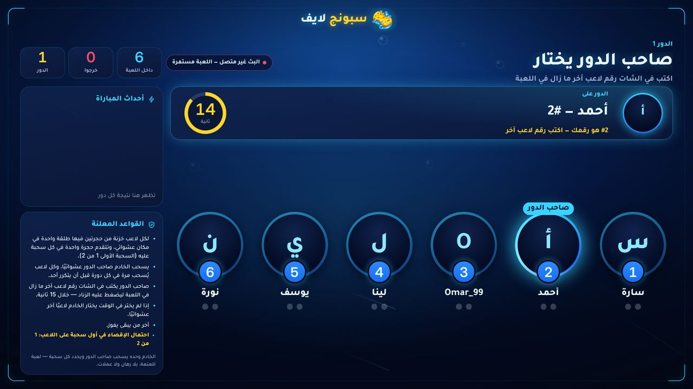
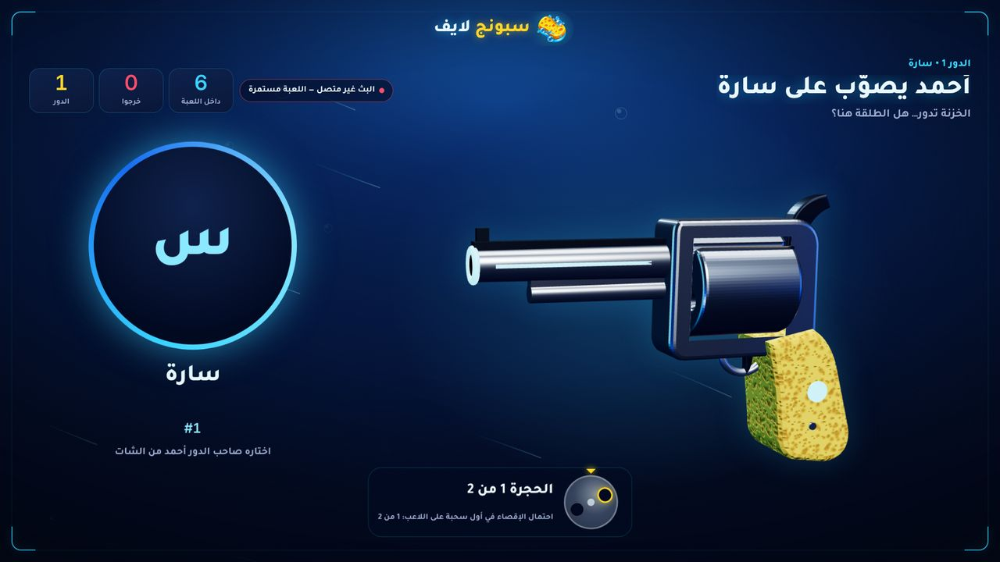
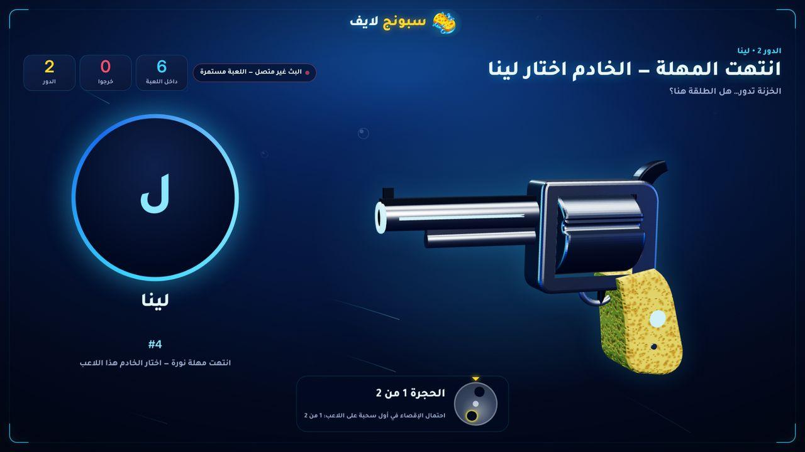
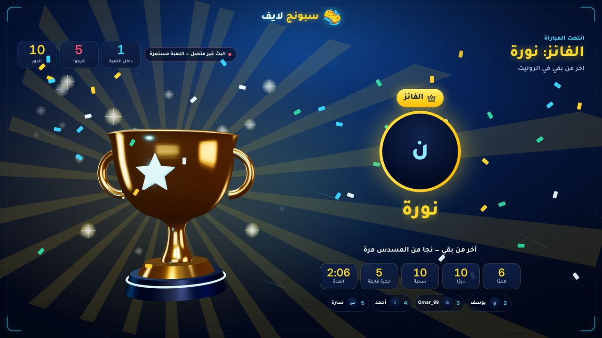
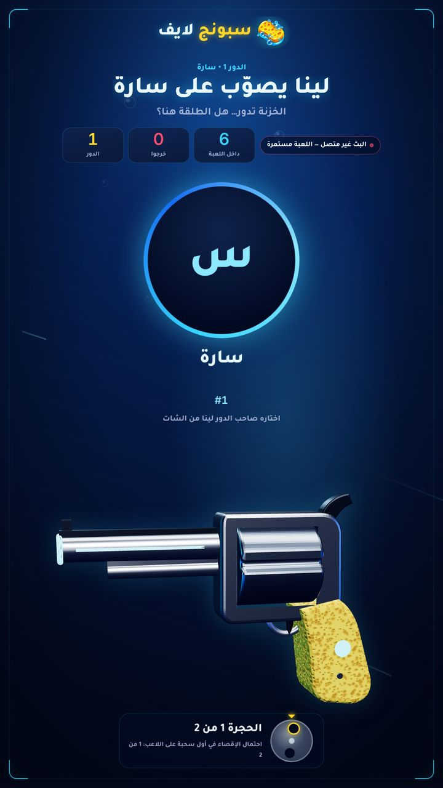
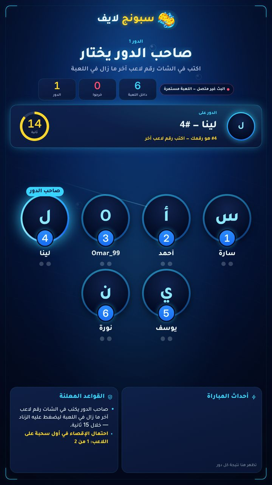
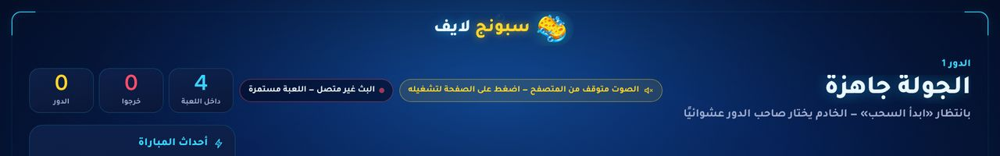
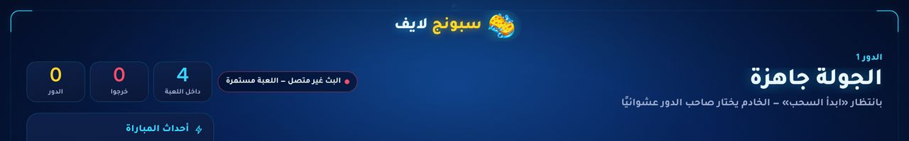

# «الروليت» P0 — the rule of the game, chat choices, sound: test report

Branch `claude/trusting-albattani-qjmrqc`, based on `main` at `55d2379`. The game stays «قيد التطوير» (only the
owner, admins and testers can open it) until the owner releases it from the admin panel.

## What was wrong (found in the read-only audit, confirmed by running the code)

| # | Problem | Evidence before the fix |
|---|---|---|
| 1 | **Default rule broke the game's rule**: `targetMode` defaulted to `self` — the drawn player faced the revolver and nobody chose anything | Simulated chat match: holder #5 drawn → target #5, `how=self` |
| 2 | Silent holder (default `timeoutRule: self`) shot **themselves** | Holder #1 silent 15 s → target #1 |
| 3 | Only a bare number was accepted; `1 🔫`, `اطلق على 1`, `@name` were silently ignored | Same simulation |
| 4 | A wrong number from the holder (own, eliminated, nobody's) got no answer on screen | Same simulation |
| 5 | Game card and games guide never said the holder chooses | `src/catalog.mjs`, `public/guide-games.html` |
| 6 | Sound silent in 3 situations: a normal browser tab before a click; the host's studio preview (always `?mute=1`); a viewer's saved site mute also silenced the OBS screen | Browser probe: 0 sounds in each case |
| 7 | A chat drop while the holder chooses could end their turn by timeout | Code reading (no pause existed) |

## What changed

**Rules (server, `src/roulette.mjs`, `src/game-settings.mjs`, `server.mjs`)**
- The holder **always** chooses: `targetMode` has one value, `choose`. A saved `self` from before reads as `choose`.
- Silent holder: `random` (a random **other** player still in) by default, or `skip` (the turn is cancelled). `self` is gone; a saved `self` becomes `random`.
- Settings page: «من يواجه المسدس؟» removed (nothing to choose). Old pages/saved lobbies that still send `targetMode`/`self` are migrated, never refused.
- `parseChoice()`: the number may be anywhere in the message — `7`, `#7`, `رقم ٧`, `7 🔫`, `اطلق على 7`, `7️⃣`, `اللاعب رقم 07`. Two different numbers → «ambiguous». Numbers longer than 4 digits (phone numbers) are ignored.
- Only the holder's message counts; other players, eliminated players, viewers who never joined, and messages outside the choice change nothing. Platform replays (same message id) count once (existing engine rule, now covered by a test).
- Wrong numbers from the holder are published as `feedback` (`self` / `out` / `missing` / `ambiguous`) so the stream can answer; the holder tries again.
- **Chat drop**: in a real match where the stream's chat was connected, a drop during the choice freezes the countdown (time left is kept) for at most 2 minutes, then the announced timeout rule decides. Matches without a stream (owner tests, trial lobby) never wait.
- Rules on screen: the choose rule is listed first, plus the timeout rule.

**Screens (`public/roulette/stage.js`, `public/roulette.css`)**
- Holder banner answers wrong numbers in yellow: «#2 هو رقمك — اكتب رقم لاعب آخر», «#4 خرج من اللعبة…», «لا يوجد لاعب برقم 99…», «اكتب رقمًا واحدًا فقط (كتبت 1 و 2)».
- Lock-in headline: «أحمد يصوّب على سارة»; after a timeout «انتهت المهلة — الخادم اختار …».
- Chat drop: «الشات منقطع — المهلة متوقفة حتى يعود الاتصال», countdown ring dimmed.
- Vertical (TikTok) layout: the rules panel shows the choose rule + the odds and no longer overflows.

**Sound (`public/roulette/sfx.js`, `public/sponge.js`, `public/studio.*`)**
- A browser that blocks sound shows «الصوت متوقف من المتصفح — اضغط على الصفحة لتشغيله» (not a control; hidden after one click; never shown in OBS, which allows sound, nor in the host's muted preview).
- The OBS screen (`/overlay`, not embedded) ignores a mute a viewer once saved on the site; the host's «الأصوات» setting still decides.
- A viewer's sound switch reaches an embedded game screen at once (storage event), without a reload.
- Studio: «صوت المعاينة: مكتوم / يعمل» in the roulette bar (off by default — OBS carries the sound; on the same PC it would play twice). Remembered in the browser; applies to the roulette preview only.

**Texts**: game card (`src/catalog.mjs`) and games guide now state the rule. `public/play.js` no longer offers the old «من يواجه المسدس؟» choice.

## Tests

Written first (TDD): each new test was run and **seen failing** before the code that makes it pass.

| Suite | Tests | Covers |
|---|---|---|
| `tests/roulette-choose.test.mjs` (new) | 13 | default rule; silent holder → other player or cancel; legacy `self` settings; chat parsing (14 valid forms, 9 non-choices, ambiguity); valid choice; wrong numbers + retry; unauthorized senders (other player, eliminated, stranger, empty id, during the draw, after the choice); chat drop pause/resume; pause cap (and «paused» cleared after it); no pause without a stream / in trial; settings page + migration; **3 end-to-end tests through `engine.receiveChat`** (the TikTok/Kick path) incl. message replay, silent holders to a winner, stream drop + return |
| `tests/roulette-choose-ui.test.mjs` (new, Playwright) | 3 | wrong numbers answered on the OBS screen, outsiders ignored, lock-in headline; sound hint shown/hidden (tab / OBS / muted preview); OBS ignores saved mute, viewer switch syncs live |
| `tests/roulette-ui.test.mjs` (+1, needs PostgreSQL) | 1 new | studio «صوت المعاينة»: muted by default, click → preview really plays the turn, remembered after reload, off again |
| `tests/roulette.test.mjs` (7 updated) | — | tests that asserted the old «self» rule now assert the new one; their purpose (deadlines, hidden outcomes, skip, fair draw, holder-only input, timeout rules) is unchanged |

Mutation checks (each fix removed on purpose → its test fails, file restored byte-for-byte): OBS honouring saved mute again; no live sync of the switch; sound hint never shown; studio switch that repaints but keeps the preview muted.

**Full suite** with an isolated throwaway PostgreSQL 16 (`localhost:55432`, deleted afterwards; production was never touched):
**356 tests — 355 pass, 0 fail, 1 skipped** (the sitemap `lastmod`-vs-git check needs full history; it runs in CI).
In one earlier full run `roulette-ui › the OBS screen follows every scene` failed once (it saw the 2.4 s revolver scene already
revealed under heavy parallel load); it passed 3/3 run alone and in the final full run — a pre-existing timing-sensitive test.

`npm run check` passes · `npm audit --omit=dev`: 0 vulnerabilities · no secrets in the diff.

**Sitemap dates (fix after the first CI run):** this PR changes the content of two public pages — `/guide/games` (its HTML)
and `/games` (the roulette card text comes from `src/catalog.mjs`, rendered into the page by the server). Their `lastmod`
in `src/seo.mjs` is now `2026-11-12`; `/`, `/guide/tiktok-live` and `/guide/tools` are unchanged (`2026-11-06`). The
`lastmod` test now also follows the data rendered into `/games`, so a catalogue change can no longer leave its date stale.

## Real browser simulations (chat only, no trial bots)

Throwaway local server, OBS screen `/overlay`, 6 viewers who joined by writing «انضم»; every target came from simulated
chat comments (`engine.receiveChat`, the TikTok/Kick path).

Landscape 1920×1080 — **10 turns, winner نورة, 0 page errors**:
```
turn 1: holder #2 أحمد → target #1 سارة (chat) → empty
   another player «3» → ignored · viewer not in game «3» → ignored
   holder: own number «2» → self · «99» → missing · «1 أو 3» → ambiguous
turn 2: holder #6 نورة stays silent 15 s → server chose #4 لينا (timeout) → out
turn 3–10: holder writes an eliminated number first («4», then «1») → «out» answer; then «اطلق على N 🔫» → chosen by chat
```
Portrait 1080×1920 — 6 turns, winner نورة, 0 page errors.

### Screenshots

| | |
|---|---|
| Wrong number (own) |  |
| Lock-in by chat |  |
| Silent holder → server's choice |  |
| Winner |  |
| Portrait: two numbers |  |
| Portrait: lock-in |  |
| Portrait: rules panel fits |  |
| Sound blocked in a tab → after one click |   |
| Studio «صوت المعاينة» off → on |   |

The landscape captures were taken just before the rules list was reordered (the choose rule is now first); the portrait captures show the final order.

## Not verified here

- A real TikTok or Kick live chat (no stream account in this sandbox) — the same `receiveChat` path was driven by simulated comments.
- The chat-drop pause on a real stream — covered by unit and engine tests, not by a browser run (the sandbox cannot drop a real connection).
- Real OBS on a streamer PC, real phones, and frame rates (no GPU here; screenshots use a software renderer).
- The revolver still has the sponge grip — the weapon redesign is planned for P2.
