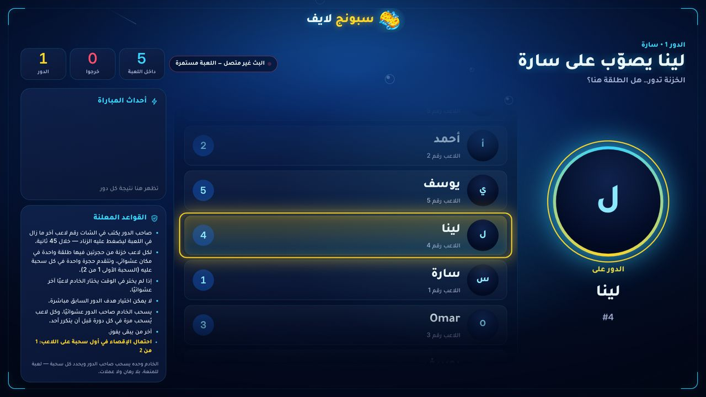
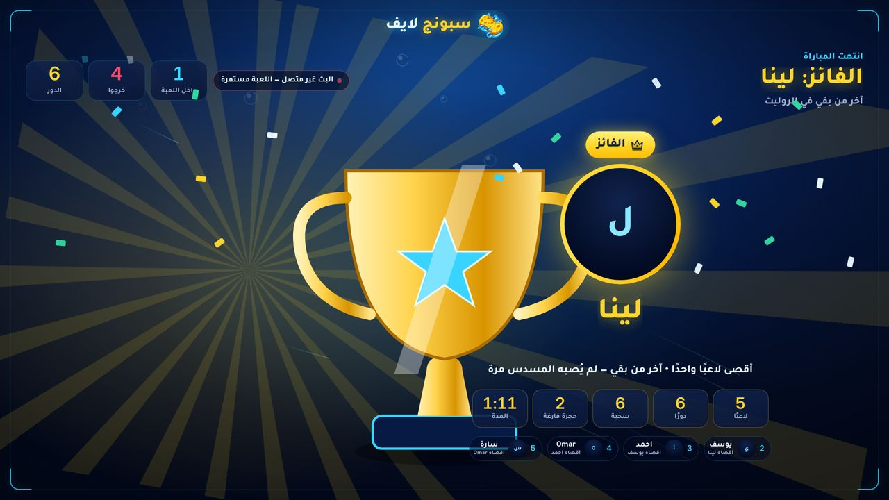

# «الروليت» P1 — the match reads like a story: test report

Builds on P0 (PR #56). The game stays «قيد التطوير» until the owner releases it.

## What changed

| | |
|---|---|
| **Lock-in beat** | After the target is known (by chat, by the host, or by the server after a timeout), the grid stays for 1.2 s: the shooter's tile, the target's tile (red ring) and a dashed red line between them, with «سارة يصوّب على أحمد». The beat is on the **server clock** (`LOCK_MS`, published as `lockMs`), so OBS, the studio and phones switch to the revolver at the same moment; the revolver keeps its full scene after it. «تخطي المشهد» still jumps to the result. |
| **Kill feed** | The match log says who pulled the trigger: «#2 أحمد أقصى #1 سارة — انطلقت الطلقة»; after a silent holder: «… خرج — اختاره الخادم بعد انتهاء المهلة». |
| **Winner screen** | «أقصى لاعبَين • آخر من بقي…» and, under each ranked player, «أقصاه …» or «اختيار الخادم». Only the holder's own choice counts as a kill (not the server's pick). |
| **Anti-bullying rule (optional)** | New setting «استهداف هدف الدور السابق»: «مسموح» (default) or «ممنوع لدور واحد». When blocked, the previous turn's target cannot be chosen at once — by the holder (answered on screen: «#N كان الهدف في الدور السابق — اختر لاعبًا آخر»), by the timeout's random pick, by the host's «هدف عشوائي», by trial players, or by the host's own pick. With only two players left it never blocks the game. Announced in the rules panel. |
| **Last five seconds** | One dry tick per second while the holder chooses (higher on the last second), on top of the existing red ring. Silent while the chat is down (the countdown is frozen then). |

Files: `src/roulette.mjs`, `src/game-settings.mjs`, `public/roulette/stage.js`, `public/roulette/sfx.js`, `public/roulette.css`.

## Tests (written first — each seen failing)

| Suite | Tests | Covers |
|---|---|---|
| `tests/roulette-polish.test.mjs` (new) | 6 | lock-in timing and skip; kill feed (`how`, `b` = eliminated by, `k` = kills, server picks are not kills); winner data; the new setting; protection for holder/timeout/host random; default «allowed» and the two-player case |
| `tests/roulette-polish-ui.test.mjs` (new, Playwright) | 2 | a whole match by chat on the OBS screen: lock-in scene + line + tile marks, kill feed, protected-target answer, winner ranking «أقصاه»; ticks only in the last five seconds (counted from the sounds the page really starts) |
| `tests/roulette.test.mjs` | 1 updated | the list of settings now includes `repeatTarget` |

**Full suite** (isolated throwaway PostgreSQL, full git history): **364 tests — 364 pass, 0 fail, 0 skipped**.
An earlier full run had one failure in `roulette-ui › the OBS screen follows every scene` (a page reload took longer than
10 s under heavy parallel browser load); it passed 3/3 alone and in the next full run. It needs PostgreSQL, so it does
not run in CI.

## Screenshots

| | |
|---|---|
| Lock-in beat (grid, line, holder and target) |  |
| Winner: kills and «أقصاه …» per player |  |

## Known, not from this change

- In «منخفض» graphics the 2D trophy's base overlaps the start of the ranking row on the winner screen; `main` does the same (checked). Planned with the 2D prop update in P2.
- The revolver still has the sponge grip (P2).

## Not verified here
Real TikTok/Kick chat, real OBS and phones, frame rates on a real GPU.
