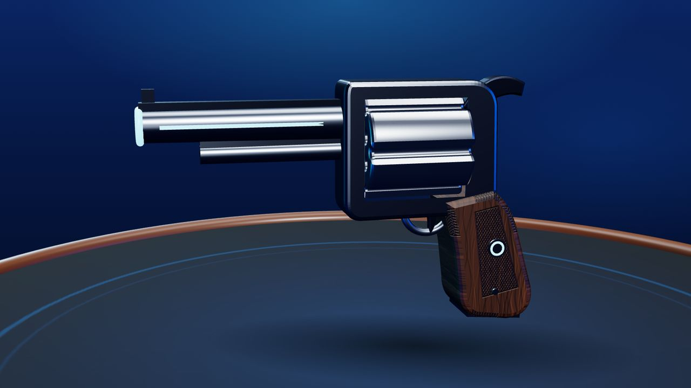
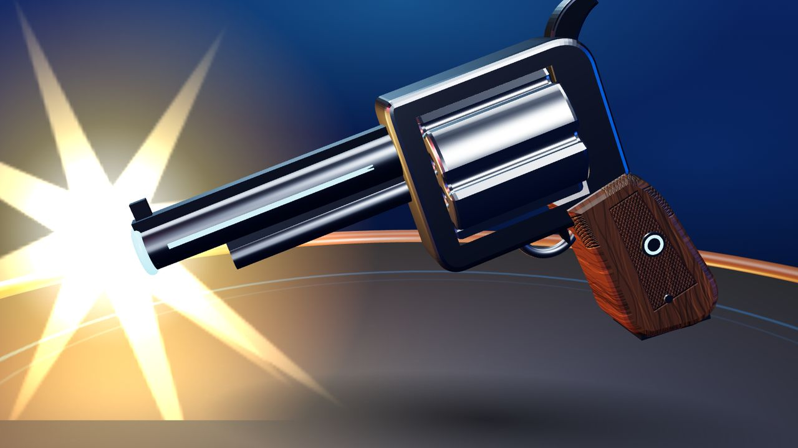
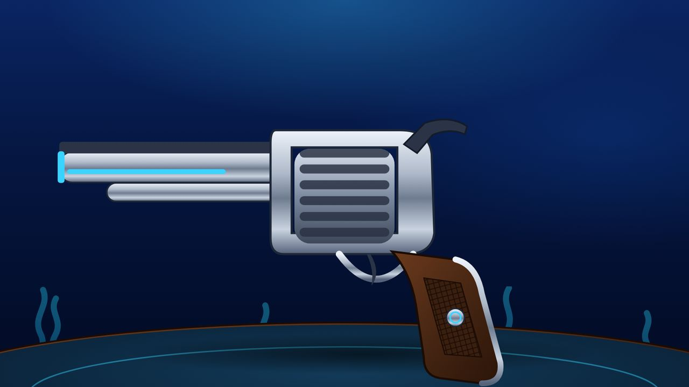
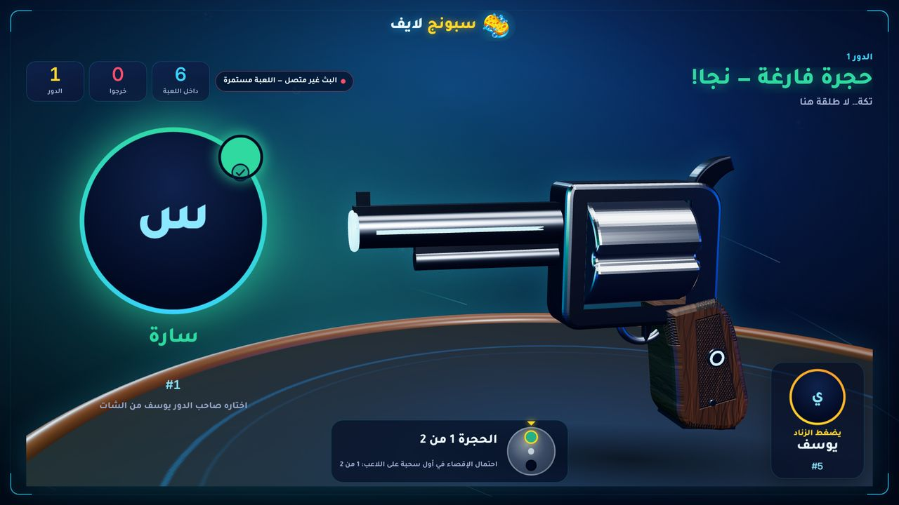
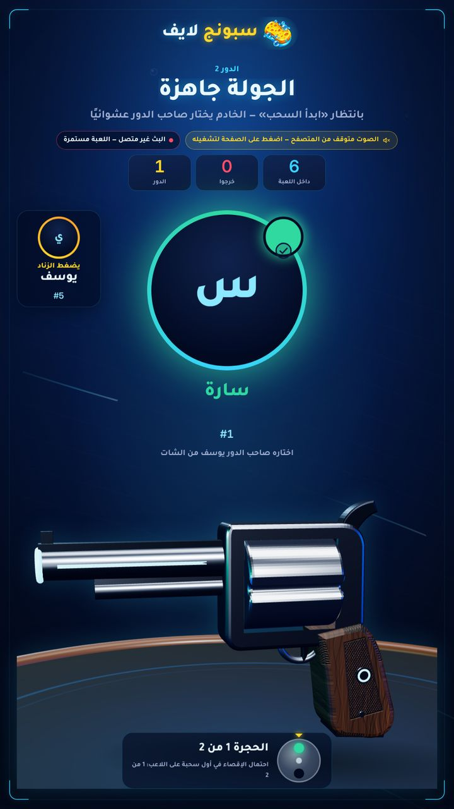
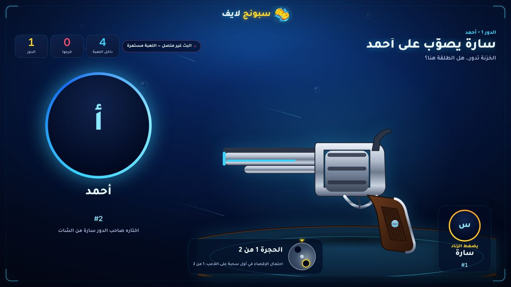
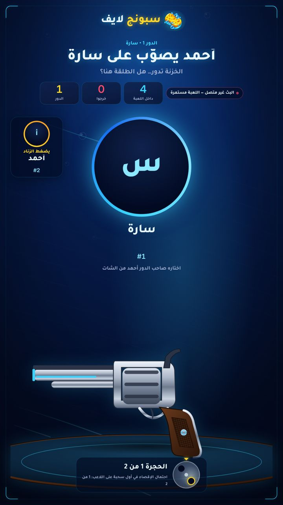
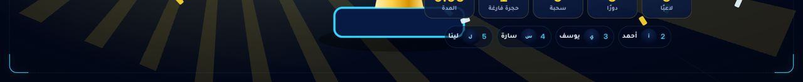
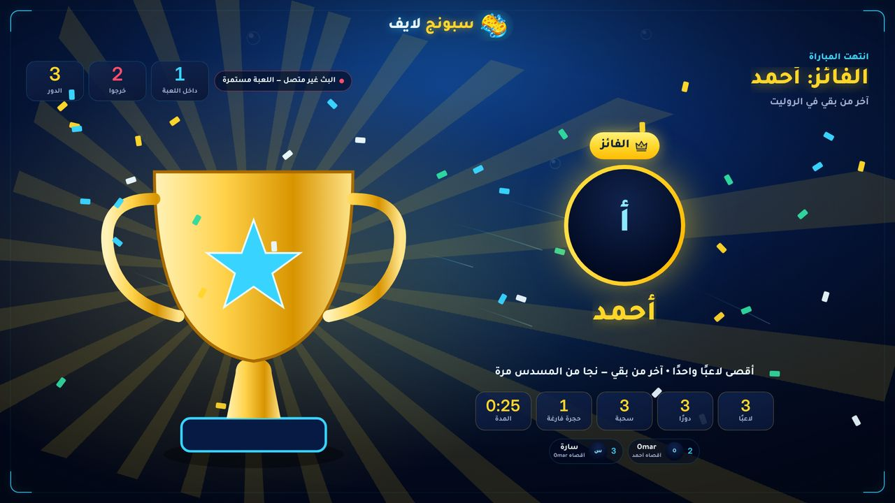

# «الروليت» P2 — a real weapon, a duel table, a cinematic camera: test report

Builds on P0 and P1 (live since 2026-11-12). The game stays «قيد التطوير» until the owner releases it. Only screen code
changed (`public/roulette/*`, `public/roulette.css`): no server, rules, settings or database change.

## What changed

| | |
|---|---|
| **Weapon without the sponge** (owner's decision) | WebGL: a lacquered walnut grip with a checkered panel (procedural grain + checkering in colour and relief maps), a steel backstrap and butt cap, a steel medallion with a small cyan inlay; a darker gunmetal frame so the polished cylinder stands out. SVG («منخفض» / no WebGL): the same grip — walnut gradient, checkered panel, steel backstrap, cyan-inlaid medallion. No yellow, no pores, nowhere. |
| **Duel table** | The revolver hovers over a round table — felt with a printed cyan ring and a painted pool of light, a walnut rim, a soft contact shadow that follows the prop. Same table in the SVG prop. |
| **Cinematic camera** | During the aim the camera starts low and to the side of the table and swings round to face the duel as the cylinder turns; the shot punches in, an empty chamber eases back. A function of the server clock only: every screen (OBS, studio, phones) shows the same shot at the same moment. No orbit with «تقليل الحركة». |
| **The shooter on screen** | The holder who chose («يضغط الزناد») now faces the target: their photo — or equipped skin and frame — name and number, in the corner by the grip (landscape) or opposite the target (portrait). After a timeout it says «صاحب الدور»; the host's own decision has no shooter. |
| **2D trophy fixed** | In «منخفض» the trophy now stands on the free side of the winner screen (like the WebGL one) instead of under the winner's card; its light sweep is clipped to the cup. |

## Tests (written first — each seen failing before the code)

`tests/roulette-p2.test.mjs` (new, Playwright, no database needed — runs in CI):

| Test | Seen failing first | Covers |
|---|---|---|
| no sponge (3D + 2D) | source still built a sponge | no `sponge`/`pores` in either prop; SVG grip is a named part, shaded, dark, never sponge-yellow; WebGL grip has no sponge material, is dark, has a relief map |
| trophy vs winner card — landscape | trophy covered the winner's name (measured boxes) | the light trophy's box never intersects the name, line, stats, ranking or photo |
| trophy vs winner card — portrait | (already passed on `main` — kept as a guard) | same |
| the duel — landscape / portrait | no shooter on screen | shooter shows the holder's number, name and photo/skin; does not overlap the target, its name, the «اختاره…» line or the cylinder HUD; the SVG table is drawn |
| 3D table + camera | no felt/wood materials | table materials present; the camera moves during the aim (yaw > 0.15 rad); the same clock gives the same camera; reduced motion: no orbit (< 0.02 rad); the shot punches in; draw calls < 90 |

One issue found while running under load: the trophy's box included its invisible (clipped) light sweep, so the
measurement depended on the moment → the solid trophy is now its own group (`data-part="trophy"`) and the test measures
it; 8/8 runs pass with four copies in parallel.

## Full suite (isolated throwaway PostgreSQL 16, deleted afterwards — production never touched)

| Run | Result |
|---|---|
| Full run 1 | 370 tests — 369 pass, 1 fail |
| Full run 2 (final code) | 370 tests — 368 pass, 2 fail |
| Each failing test alone | 3/3 pass |

The failures are load-sensitive tests that need PostgreSQL (not run in CI):
- `roulette-ui › the OBS screen follows every scene…` — **fails on `main` too** under the same load (measured: a clean
  checkout of `main` failed it 2/2 when run with the same browser test files); it races a 2.4 s scene and a 5 s result
  window. An attempt to harden it was reverted to keep this PR to P2; it is left as it is on `main`.
- `roulette-http › the roulette on the server…` (one run) — server-only, HTTP only; P2 changes no server code. A trial
  bot must choose within 8 s; passes 3/3 alone.

`npm run check` passes. `npm audit` unchanged (no dependency change).

## Performance (same frame, `main` vs P2, Chromium software WebGL — no GPU in this sandbox)

| | `main` | P2 |
|---|---|---|
| Draw calls (aim / shot) | 66 | 75 |
| Triangles | 20,894 | 26,988 |
| Geometries / textures | 22 / 8 | 29 / 10 |
| CPU time per frame (submit; 4 measurements each, noisy) | 0.3–1.2 ms | 0.9–1.3 ms |
| Page freeze while the prop is built | 0.18–0.28 s | 0.17–0.24 s |
| First revolver frame | 0.45–0.68 s | 0.52–0.65 s |

Two ideas were measured and dropped: a warm-up render at creation froze the page ~1 s (in software rendering) during
the draw, and a real spotlight made every shader heavier (first revolver frame up to 1.2 s). The light pool is painted
into the felt instead, and an additive light cone was dropped because it lit up the canvas' rectangle on the page.
Real GPU frame rates were not measured (no GPU here).

## Screenshots

| | |
|---|---|
| Weapon, WebGL (aim) |  |
| Weapon, WebGL (the shot: flash, punch-in) |  |
| Weapon, SVG («منخفض») |  |
| Duel, WebGL, landscape (camera mid-swing; shooter by the grip) |  |
| Duel, WebGL, portrait |  |
| Duel, SVG, landscape / portrait |   |
| Winner, «منخفض»: before (`main`, trophy base under the ranking) → after |   |

Screenshots come from Chromium's software renderer; on a real GPU edges are smoother.

## Not verified here

- Real OBS on a streamer PC, real phones, real GPU frame rates.
- Player skins with real images: the shooter uses the same avatar code as the target and the grid (photo, equipped
  skin, frame), checked with letter avatars only — no account skins in this sandbox.
- The weapon is an original, code-built prop (no model file, no third-party asset, nothing to license).
