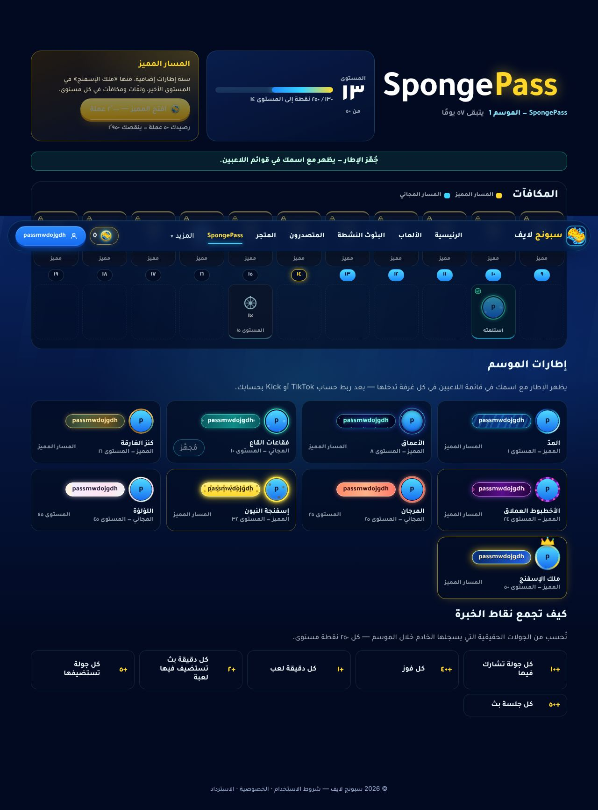
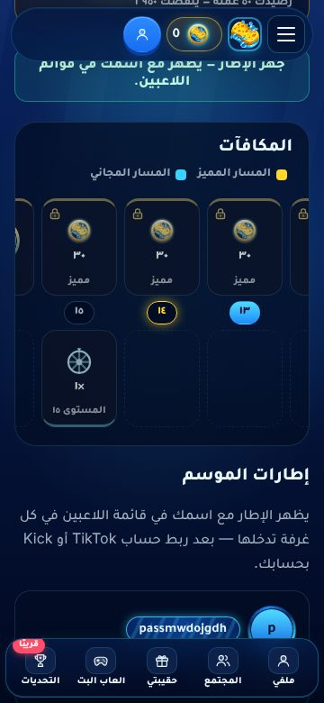

# SpongePass — the season pass

A 50-tier season pass with a free track and a premium track. Its frames appear with the player's name in the
lobby's player list (and everywhere else frames show), like any other frame.

Owner decisions (asked before building): premium bought with **Sponge Coins**; **60-day seasons, 50 tiers**; a new
**code-built frame set**; rewards = **frames + Sponge Coins + free wheel spins + a season badge**.

## How it works

| | |
|---|---|
| **Season 1** | «SpongePass — الموسم 1»: Sunday 8 Nov 2026 00:00 (Riyadh, the leaderboard's week start) → 7 Jan 2027, 60 days. Seeded by `migrations/022_spongepass.sql`. |
| **XP and tiers** | From the server's weekly statistics of real, listed game sessions inside the season, with the same rules as the account level (`XP_RULES`): +10 per round joined, +40 per win, +1 per minute played, +50 per stream session, +2 per minute hosting, +5 per round hosted. 250 XP per tier, 12 500 for tier 50 — about 60 days for a regular viewer (~210 XP a day). A viewer's games count once their TikTok/Kick account is linked and verified (as for the level). Nothing comes from the browser. |
| **Free track** | Frames at 10, 25, 45 · 1 free spin at 15 and 35 · coins at 5 (50), 20 (75), 30 (75), 40 (100) · the season badge at 50. |
| **Premium track** | 2 000 coins, once per season (purchased coins first, then earned ones — like a skin). A reward on every tier: frames at 1, 8, 16, 24, 32, 50 («ملك الإسفنج»), free spins on 8 tiers (3 at tier 40), 30–50 coins on the others (1 450 in all: the premium track does not pay itself back in coins). The owner can grant it (`/api/manage/pass-premium`, audited) and take a granted one back; a bought one is never taken back. |
| **Claims** | Each reward once: `(user, season, tier, track)` is the primary key, inside one transaction with the wallet row locked — a double click, 20 parallel requests or a replay grant once. «استلم كل الجاهز» takes everything reached. Rewards stay claimable after the season ends. |
| **Frames** | Nine new frames drawn by CSS (no image to download): فقاعات القاع (common), المدّ, المرجان (rare), الأعماق, كنز الغارقة, اللؤلؤة (epic), الأخطبوط العملاق, إسفنجة النيون (legendary), ملك الإسفنج (mythic, with a crown). Won frames are ordinary owned frames (source `pass`): equipped from the pass page or «حقيبتي», they show in the lobby list for the account's linked TikTok/Kick handle. They respect the host's «تأثيرات الإطارات» switch and reduced motion. |
| **Free spins** | A single spin of «عجلة السكنات» uses a free spin first (cost 0, recorded with bucket `free`). |
| **Badge** | Listed on the pass page and shown next to the name on the public profile. |

Reward table: `rewardsFor()` in `src/spongepass.mjs` (one place to change it). Page: `/pass` (signed-in; guests go to
sign-in and come back). Links: the yellow «SpongePass» in every page's top bar, the phone menu, and the account menu.

## Files

`migrations/022_spongepass.sql` · `src/spongepass.mjs` (new) · `src/economy.mjs` (free spins) · `src/frames.mjs` (effects) ·
`server.mjs` (routes, `/pass`, profile badges) · `public/pass.{html,js,css}` (new) · `public/frames.{css,js}` (the nine frames) ·
`public/site-header.js`, `public/shared-theme.css`, `public/me.html`, `public/profile.js` (links, badge) ·
`public/admin-economy.js` (the new effects in the owner's frame editor — without them, saving a pass frame there would have
reset its effect to «none») · `public/lobby.css` (crowns stay inside the list's row gap).

## Tests

- `tests/spongepass.test.mjs` (5, PostgreSQL): the reward table; season XP (only weeks inside the season, unlinked accounts
  count nothing, cap at 50); claims (once for 20 parallel requests, only reached tiers, premium only for members); premium
  (5 parallel purchases → one, purchased coins first, refused without enough, owner grant/revoke, «claim all» once); a pass
  frame equipped → the lobby lookup by linked handle returns it, a premium frame not owned cannot be equipped; a free spin
  costs no coins; the badge.
- `tests/spongepass-ui.test.mjs` (1, Playwright + PostgreSQL): guest → sign-in redirect; a real account with season statistics
  sees tier 13 and 50 columns, premium locked; «استلم كل الجاهز» takes the two free rewards (50 coins credited once); the frame is
  equipped from the page and the room's lookup returns it for the linked TikTok handle; the bar's link; no sideways scroll on a
  360 px phone.
- **Process note:** `src/spongepass.mjs` was written before its tests (not test-first). To compensate, five mutations were
  applied one at a time — grant twice, count weeks outside the season, unlock premium, charge a free spin, spend earned coins
  first — and each one made the tests fail; the files were restored byte-for-byte.
- Full suite (isolated throwaway PostgreSQL, deleted afterwards): **383 tests — 381 pass, 2 fail**. One was the brand test
  catching a hard-coded brand yellow in the new frames — fixed (it passes 5/5 now). The other is the known load-sensitive
  `roulette-ui › OBS screen…` (fails on `main` too under load; 4/4 alone).

## Screenshots

| | |
|---|---|
| The nine frames on lobby nameplates |  |
| The pass page (tier 13, free rewards claimed, a frame equipped) |  |
| On a phone (the track scrolls inside itself) |  |

## Not verified / later

- A frame in a **live** lobby fed by real TikTok/Kick chat (no stream here): the lobby's lookup was checked directly for the
  linked handle — the same path the room uses — and the frames were seen rendered in the lobby's own plate styles.
- Season 2: the season table supports more seasons; starting one (dates, rewards, frames) is a later owner step — the reward
  table is in code (`rewardsFor`).
- The premium price (2 000) and the XP pace are first guesses; both are one-line changes.
